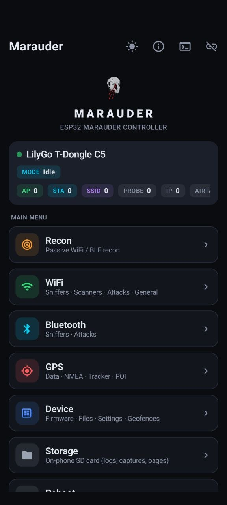
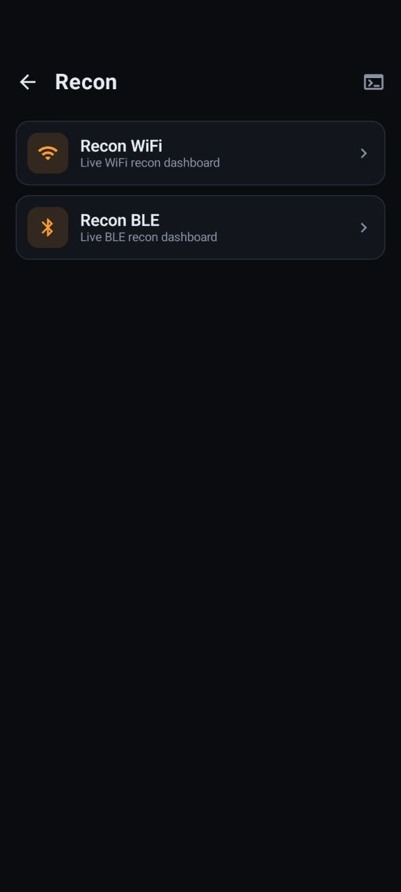
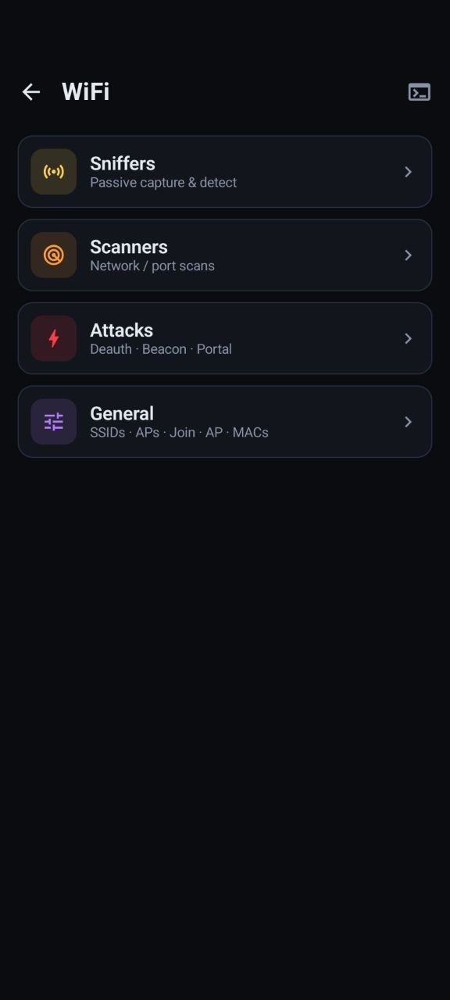
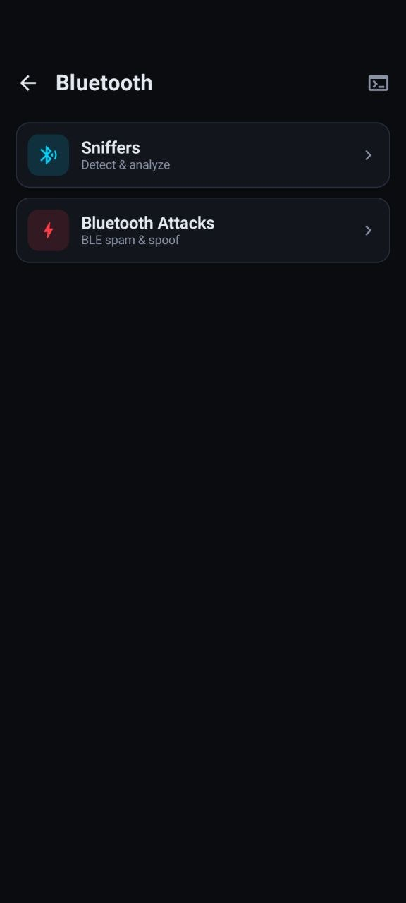
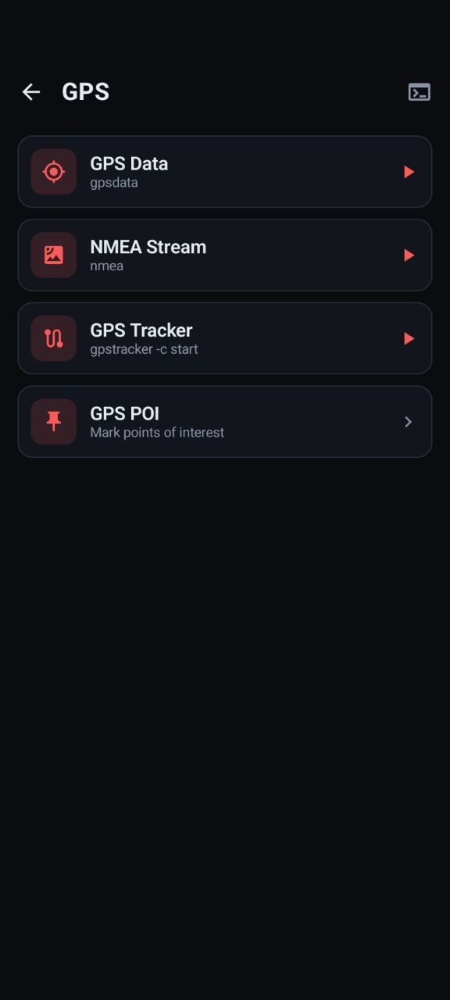
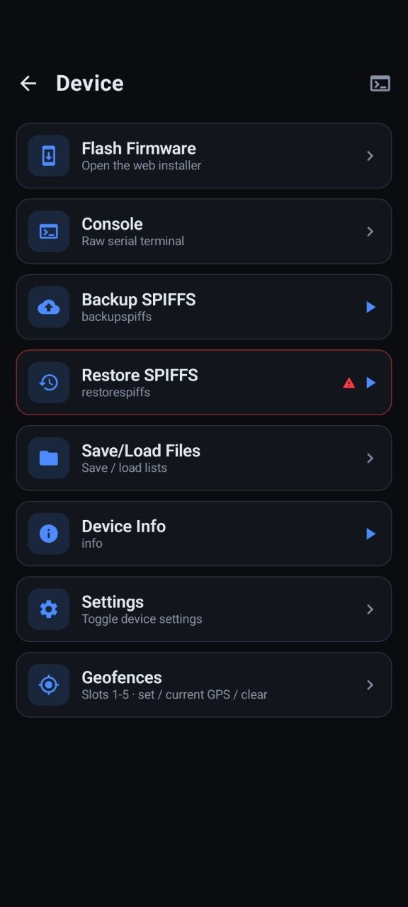
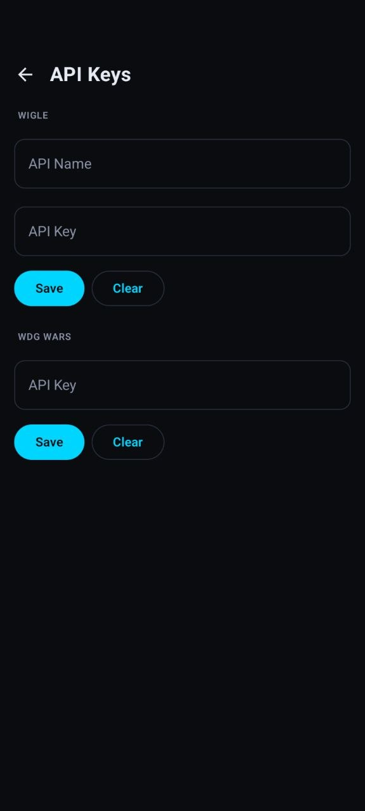
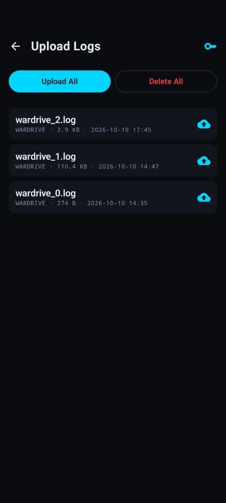
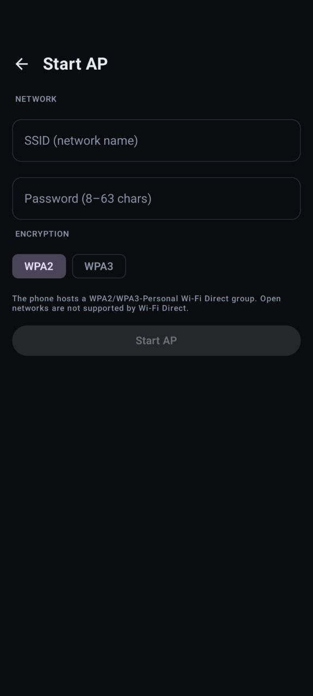

<div align="center">


# Marauder Mobile

**An Android controller for the [ESP32 Marauder](https://github.com/justcallmekoko/ESP32Marauder).**
Drive the firmware entirely over USB — no PC, no server, no extra hardware.

Forked and developed from the original by **Mohammed Ali** · GitHub [@0xsys](https://github.com/0xsys)

</div>

---

## What it is

Marauder Mobile is a native Kotlin / Jetpack Compose app that turns an Android
phone into a full control surface for an ESP32 running **stock upstream Marauder
firmware v1.18.0**. It talks to the board over USB-OTG serial and drives the
firmware's own command-line interface, parsing the human-readable CLI output plus
the narrow `@MARAUDER:{…}` machine-protocol lines the firmware emits for
`protocolinfo --machine`. It needs **no firmware modifications** — the app is
control-only and works with an unmodified upstream board, letting you use the
Marauder headlessly, without its screen.

The UI mirrors the on-device touchscreen menus one-to-one (same titles, same
ordering): **WiFi → Sniffers / Scanners / Attacks / General**, **Bluetooth →
Sniffers / Attacks**, **GPS**, **Device**. Every command opens its own **live
results screen** that streams in real time. WiFi and Bluetooth come from the
connected device; GNSS comes from the phone (the board needs no GPS module).

<div align="center">


&nbsp;

&nbsp;



&nbsp;

&nbsp;



&nbsp;

&nbsp;


</div>

## Requirements

- **An ESP32 running stock Marauder firmware v1.18.0** — that's it.
  No fork, no firmware changes, no server, no desktop tool, no second device.
- An Android phone (Android 8.0 / **API 26+**) with **USB host / OTG** support.
- A USB-C / USB-OTG cable between the phone and the board.

Supported serial bridges: Silicon Labs CP210x, CH340 / CH9102, FTDI, PL2303, and
Espressif native USB-CDC (ESP32-S2 / S3 / C3 /C5). The app can auto-launch when the
board is plugged in. This fork tested on LilyGo T-Dongle C5.

## Usage

1. Flash your ESP32 with upstream Marauder firmware v1.18.0 using the official
   Marauder web installer — see [Firmware](#firmware) below. No special build is
   required.
2. Connect the board to your phone with a USB-OTG cable. Android offers to open
   **Marauder** and grants USB permission — or open the app first and tap
   **Connect**.
3. The app opens the port at **115200 8N1**, waits for the board to settle, then
   handshakes with `protocolinfo --machine` to read board / firmware /
   capabilities. Upstream has no status command, so the status panel's live
   counters are synthesised from the device's own lists.
4. Browse the menus. Each entry runs a real firmware command and opens a live view:
   - **Lists** — access points, stations, SSIDs, probes, IPs, AirTags, BLE devices
     (read with `list -a|-c|-s|-p|-i|-t|-b`).
   - **Analyzers** — Packet Monitor, Channel Analyzer, Channel Summary and BT
     Analyzer, reconstructed by the app driving `sniffraw` / `channel` / `sniffbt`
     and parsing the serial output.
   - **Console** — a raw serial terminal for anything not in the menus.

> ⚠️ The attack and spam features (deauth, beacon spam, BLE spam, …) are for
> **authorised testing only**. Use them exclusively on devices and networks you
> own or have explicit permission to test. You are responsible for complying with
> local law.

## Features

- 📡 Full WiFi suite — sniffers, scanners, and attacks with live counters.
- 🔵 Bluetooth over the connected device — BLE sniffers, iBeacon, FindMy / AirTag,
  Flipper and Flock detection, and device-driven fox hunt. The one case the
  firmware cannot serve over serial — iBeacon UUID / Tx Power / MAC detail and a
  Meta fox-hunt meter — falls back to the phone's own BLE radio.
- 🛰️ GNSS from the phone — wardrive (WiFi + Bluetooth + Flock from the device,
  tagged with the phone's fix), tracker, NMEA stream, points of interest, and
  geofences.
- 📈 Live analyzers — Packet Monitor, Channel Analyzer, BT Analyzer, Channel Summary.
- 🛰️ Recon — the device's own `recon wifi` / `recon ble` mission, polled live.
- 📶 Remote ID radar, device Settings and Geofences, and Evil Portal with a
  phone-supplied HTML page.
- 🧩 App-side stand-ins for functions the firmware exposes no serial command for —
  Start AP, Host AP Info, and Manage Saved WiFi.
- 🗂️ Structured device lists parsed straight from the firmware.
- ☁️ WiGLE / log upload from the phone.
- 🖥️ Raw serial console.
- 🎨 **Light & dark themes** — toggle from the main screen; the choice persists.
- 🔌 Auto-detect & auto-connect on USB attach.

## Protocol (firmware ↔ app)

- **App → device:** plain firmware CLI commands + `\n` — e.g. `scanap`, `sniffbt`,
  `list -a`, `foxhunt -b <i>`, `recon wifi`, `settings`, `geofence set …`. The app
  also sends `protocolinfo --machine <tx>` to get a tagged completion sentinel and
  the identity handshake.
- **Device → app:** ordinary human-readable CLI output, plus the narrow
  `@MARAUDER:{…}` machine lines upstream emits for `protocolinfo --machine`
  (firmware / protocol / capabilities on handshake, tagged list-completion
  sentinels, and SPIFFS results). Everything else is treated as console text.

See `protocol/UpstreamParser.kt` and the firmware's `CommandLine.cpp` for the
source of truth.

## Themes

The app ships a dark theme (default) and a light theme. Toggle it from the icon
in the main screen's top bar; the choice is saved with DataStore and restored on
next launch.

## Building

Requirements: **JDK 17**, the **Android SDK** (compileSdk 35), and the bundled
Gradle wrapper (8.9). Point `local.properties` at your SDK:

```properties
sdk.dir=/path/to/Android/sdk
```

**Debug build + unit tests:**

```bash
./gradlew :app:assembleDebug :app:testDebugUnitTest
```

**Release build:**

```bash
./gradlew :app:assembleRelease
```

The signed APK lands at `app/build/outputs/apk/release/app-release.apk`.

### Release signing

Release signing is driven by an optional `keystore.properties` at the project
root. It (and the keystore) are **git-ignored** and must never be committed. Both
the debug and release build types sign with the same release key, so any APK the
project produces updates over any other without an uninstall; v1 + v2 + v3 schemes
are enabled for broad sideload compatibility. If the file is absent, the release
build still compiles — just unsigned.

Create a keystore and a matching properties file:

```bash
keytool -genkeypair -v \
  -keystore marauder-release.jks -alias marauder \
  -keyalg RSA -keysize 2048 -validity 10000 \
  -dname "CN=Your Name, O=YourOrg, C=XX"
```

```properties
storeFile=marauder-release.jks
storePassword=your-store-password
keyAlias=marauder
keyPassword=your-key-password
```

Keep the keystore and its passwords private. `keystore.properties` and `*.jks`
are already git-ignored.

## Project layout

```
app/src/main/java/com/marauder/mobile/
├── data/          # menu catalog, list types, settings, storage, saved WiFi, uploaders
├── protocol/      # UpstreamParser (CLI + @MARAUDER), DeviceMessage model, SerialDemux
├── usb/           # USB-OTG serial transport
├── ble/           # phone BLE fallback (iBeacon detail + Meta fox hunt only)
├── wifi/          # phone-hosted Wi-Fi Direct AP (Start AP / Host AP Info)
├── location/      # phone GNSS (wardrive / geofence tagging)
├── capture/       # on-phone capture sink
├── vm/            # MarauderViewModel (state + command orchestration)
├── ui/            # Compose screens, components, theme, navigation
├── MarauderApp.kt
└── MainActivity.kt
```

## Firmware

This app targets **stock upstream ESP32 Marauder firmware v1.18.0** — no fork and
no firmware modifications. Flash it with the official Marauder web installer or a
release from the upstream project, then connect over USB-OTG.

- Upstream Marauder: <https://github.com/justcallmekoko/ESP32Marauder>

## Credits

- Original Marauder Mobile by **Mohammed Ali** — GitHub [@0xsys](https://github.com/0xsys)
- This fork: <https://github.com/JCrossTX/ESP32-Marauder-Mobile>
- ESP32 Marauder firmware by [justcallmekoko](https://github.com/justcallmekoko/ESP32Marauder)

## License

Released under the [MIT License](LICENSE).
